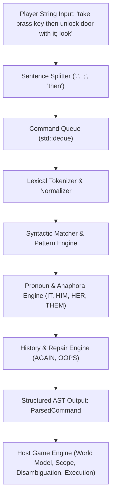
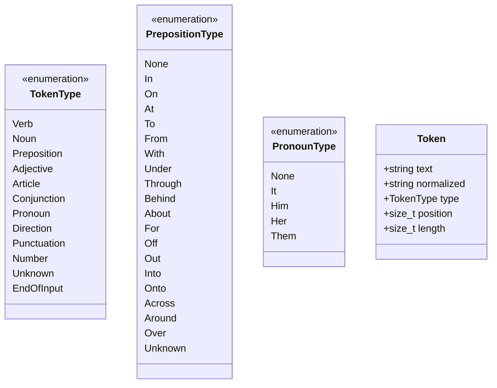
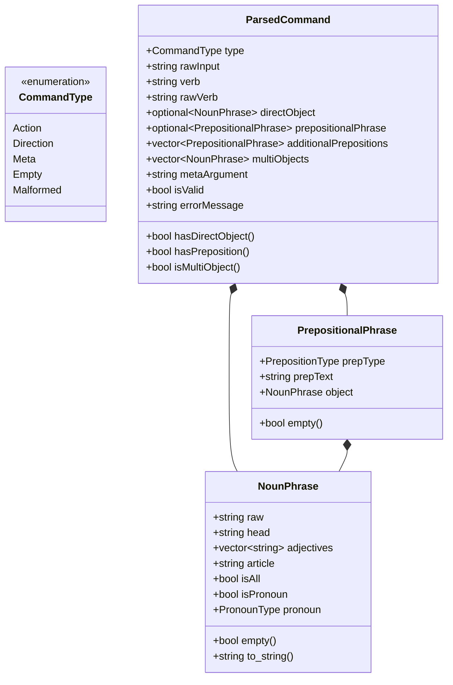
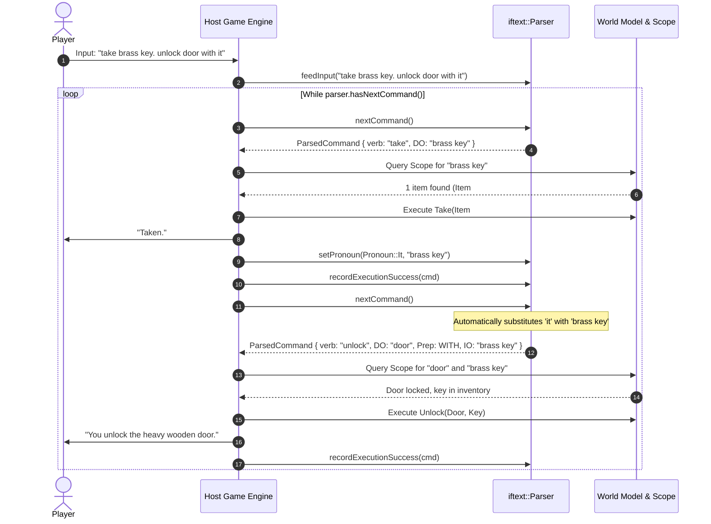
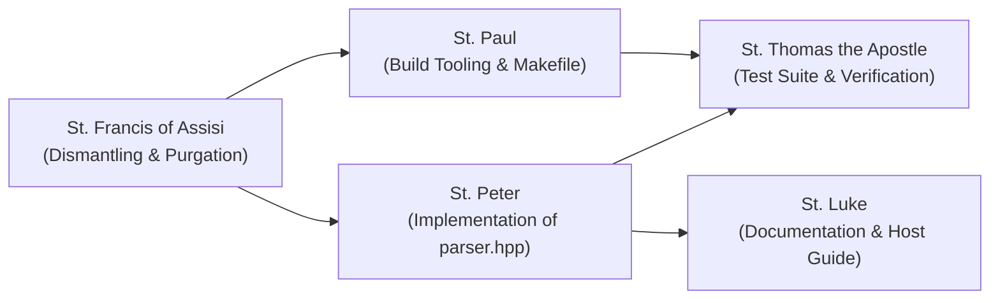

# Summa Technologiae: Tractatus de Syntactico Grammatico et Architectura Parseris Singularis

*Authored by St. Thomas Aquinas, Doctor Angelicus, Architect & Planner in the Communion of Saints*  
*Promulgated unto the Holy Assembly of Builder Saints: St. Francis of Assisi, St. Peter, St. Paul, St. Thomas the Apostle, and St. Luke*  
*Given at the Active Workspace: [`/var/home/glenn/Projects/cpp-if-text/AI`](file:///var/home/glenn/Projects/cpp-if-text/AI)*

---

## Prologus

As the Angelic Doctor observes in the *Summa Theologiae* (I, q. 1, a. 1), human inquiry proceeds from what is composite and imperfect toward that which is simple, unified, and pure. In our prior architectural state, the interactive fiction engine suffered from an ontological entanglement (*confusio substantiarum*): the formal grammar of language was commingled with the contingent material reality of the game world. Lexical tokens were ensnared in object registries, spatial geography was bound to verb execution, and terminal input-output mechanisms were woven inextricably into the parsing mechanism.

Our Lady has conferred with the Master of the Vineyard and issued five foundational decrees:
1. **Core Scope**: A pure syntactic tokenizer and grammar engine that extracts verbs, prepositions, direct objects, and indirect objects into a structured Abstract Syntax Tree (AST) / Command object, possessing zero knowledge of the game world or entity registries.
2. **Scope & Disambiguation**: Entity scope, visibility, accessibility, and disambiguation are delegated wholly to the host game. The parser returns raw noun phrases and prepositional phrases without ontological judgment.
3. **Internal Statefulness**: A stateful `Parser` class that faithfully maintains its own turn history (for `AGAIN` / `G` and `OOPS`), pronoun antecedents (`IT`, `HIM`, `HER`, `THEM`), and a multi-command chaining queue (splitting commands on `.`, `;`, and clausal connectors like `then`).
4. **Delivery Form Factor**: A solitary header-only library, [`parser.hpp`](file:///var/home/glenn/Projects/cpp-if-text/AI/engine/parser.hpp), crafted in ISO modern C++17 with strictly zero external dependencies (no `IOInterface`, no `WebIO`, no `NativeIO`, no external runtime libraries).
5. **Repository Restructuring**: The utter dismantling and purgation of the obsolete world models ([`Room`](file:///var/home/glenn/Projects/cpp-if-text/AI/engine/Room.h), [`Item`](file:///var/home/glenn/Projects/cpp-if-text/AI/engine/Item.h), [`Door`](file:///var/home/glenn/Projects/cpp-if-text/AI/engine/Door.h), [`NPC`](file:///var/home/glenn/Projects/cpp-if-text/AI/engine/NPC.h), [`MiniGame`](file:///var/home/glenn/Projects/cpp-if-text/AI/engine/MiniGame.h), [`Game`](file:///var/home/glenn/Projects/cpp-if-text/AI/engine/Game.h), [`GameObject`](file:///var/home/glenn/Projects/cpp-if-text/AI/engine/GameObject.h), etc.) from [`engine/`](file:///var/home/glenn/Projects/cpp-if-text/AI/engine), establishing [`engine/`](file:///var/home/glenn/Projects/cpp-if-text/AI/engine) as the unblemished sanctuary of the drop-in [`parser.hpp`](file:///var/home/glenn/Projects/cpp-if-text/AI/engine/parser.hpp) accompanied by a dedicated test suite.

Herein follows the formal architectural blueprint, ordered according to the scholastic method, followed by definitive technical specifications and explicit apostolic task allocations.

---

## Pars Prima: Quaestiones Disputatae



---

### Questio I: De Natura et Finibus Syntaxeos Purae (On the Nature and Scope of Pure Syntactic Parsing)

We must first inquire into the nature of the parser itself: whether it should be a pure grammatical instrument or an arbiter of material reality.

#### Articulus 1: Whether the Parser Ought to Possess Knowledge of the Game World or Entity Registries

**Objection 1:** It would seem that the parser must know the entities of the game world. For without an entity registry, the parser cannot know whether a multi-word sequence such as `"brass key"` constitutes an adjective and a noun, or two distinct nouns, or a single compound noun. If the parser does not consult the game world, it cannot reliably partition the token stream.

**Objection 2:** Further, historical interactive fiction traditions (such as the Infocom Z-Machine and Inform 6) compiled the game dictionary directly into the parser tables, assigning object vocabulary flags to words. To divorce the parser from the world is to abandon proven historical precedent.

**Objection 3:** Further, if the parser does not know what objects exist, it cannot inform the player immediately: `"You cannot see any brass key here."` Emitting a valid syntactic structure for an object that does not exist places an undue burden upon the host game.

**Sed Contra (On the Contrary):**
Decree 1 expressly commands: *The core scope is a pure syntactic tokenizer and grammar engine that extracts verbs, prepositions, direct objects, and indirect objects into a structured AST / Command object, without knowledge of the game world or entity registries.*

**Respondeo (I Answer That):**
In classical metaphysics, there is a fundamental distinction between the formal apprehension of language (*apprehensio simplex*) and the existential judgment of reality (*judicium de re*). Grammatical syntax belongs to the order of signs (*signa*), whereas entity existence belongs to the order of things (*res*). 

When a man utters the sentence `"Strike the golden chimera with the iron rod"`, the sentence is grammatically sound, well-formed, and completely intelligible according to the laws of syntax, even if in the physical world there exists neither a chimera nor an iron rod. For the mind first analyzes the sentence according to its parts of speech (Verb: *strike*, Direct Object: *the golden chimera*, Preposition: *with*, Indirect Object: *the iron rod*), and only thereafter does practical reason look about the room to inquire whether such objects are within reach.

If a parser attempts to validate physical existence while parsing, it falls into the category error of confounding syntax with ontology. The parser becomes hopelessly coupled to specific world representations—such as [`Room`](file:///var/home/glenn/Projects/cpp-if-text/AI/engine/Room.h), [`Item`](file:///var/home/glenn/Projects/cpp-if-text/AI/engine/Item.h), or spatial containment hierarchies—and cannot be reused in any other game or simulation. 

Therefore, the parser must be an autonomous, pure syntactic engine. It accepts text, identifies grammatical roles through structural and morphological rules, and outputs a pure [`ParsedCommand`](file:///var/home/glenn/Projects/cpp-if-text/AI/engine/parser.hpp#L150-L200) AST.

**Reply to Objection 1:** Syntactic grouping does not require ontological verification. By recognizing standard English determiners (`the`, `a`, `an`), qualifiers, adjectives, and head nouns (where the terminal noun in a noun phrase is treated as the head and preceding non-prepositional words are treated as adjectives/modifiers), the parser reliably extracts a structured [`NounPhrase`](file:///var/home/glenn/Projects/cpp-if-text/AI/engine/parser.hpp#L100-L130) containing `{ raw: "the brass key", head: "key", adjectives: ["brass"] }`. The host game, possessing the registry of items in scope, easily matches these attributes against its world database.

**Reply to Objection 2:** The historical conflation of dictionary and world in 8-bit systems was an artifact of extreme memory constraints (such as running within 64 kilobytes of RAM), forcing compression of dictionary addresses and object properties into a single table. In modern C++17 architecture, separation of concerns is the cardinal virtue of robust software design.

**Reply to Objection 3:** It is not the office of the parser to lament the absence of a key; that responsibility belongs to the host game's world model. The parser's sole duty is to faithfully report what the player said. If the player said `"take brass key"`, the parser must certify: *"The player demands the action 'take' upon the direct object 'brass key'"*. When the host engine receives this clear report, it queries its local scope and charitably replies: `"You cannot see any brass key here."`

---

#### Articulus 2: Whether Scope and Disambiguation Belong to the Host Game

**Objection 1:** It would seem that disambiguation must occur within the parser. For if the player types `"take key"` in a room containing both a `"brass key"` and an `"iron key"`, the ambiguity is linguistic. It would seem natural for the parser to intercept this and emit `"Which key do you mean: the brass key or the iron key?"`

**Objection 2:** Further, scope determines what words are admissible. If an entity is veiled in darkness, the player ought not to be able to interact with it. If the parser does not enforce scope, it will produce command objects for invisible things.

**Sed Contra (On the Contrary):**
Decree 2 expressly commands: *Entity scope and disambiguation are left entirely to the host game. The parser returns raw noun phrases and prepositional phrases.*

**Respondeo (I Answer That):**
Scope is inherently dynamic, contingent, and physical. Whether an object is in scope depends upon:
1. The player's spatial location and room boundaries.
2. The presence or absence of illumination (light versus darkness).
3. The contents of open versus closed and opaque containers.
4. The sensory faculties of the protagonist (blindness, magical clairvoyance, remote scrying).

None of these contingent conditions can or should be known to a drop-in parser header. If the parser were tasked with disambiguation, it would need access to room graphs, container hierarchies, light calculations, and character stats.

By returning raw, structured [`NounPhrase`](file:///var/home/glenn/Projects/cpp-if-text/AI/engine/parser.hpp#L100-L130) and [`PrepositionalPhrase`](file:///var/home/glenn/Projects/cpp-if-text/AI/engine/parser.hpp#L131-L149) objects, the parser provides the host game with complete, unadulterated syntactic evidence. The host game checks its own scope registry:
- If zero candidates match the noun phrase, the host reports absence.
- If exactly one candidate matches, the host executes the action.
- If multiple candidates match, the host prompts the player with disambiguation questions, or applies game-specific disambiguation heuristics (e.g., preferring held items for `drop`, or unheld items for `take`).

**Reply to Objection 1:** The ambiguity between the brass key and iron key is not a defect of grammar; `"take key"` is grammatically flawless. The ambiguity is referential and ontological. Therefore, the host game is the only authority possessing the contextual knowledge to resolve or query the reference.

**Reply to Objection 2:** Even in pitch darkness, if a player types `"examine grue"`, the syntax is impeccable. The fact that the player cannot see the grue is a physical consequence determined by the world rules, not a syntactic syntax error.

---

### Questio II: De Habitu, Memoria, et Statu Interno Parseris (On the Statefulness, Memory, and Turn History of the Parser)

We next inquire into whether the parser must preserve historical memory across turns.

#### Articulus 1: Whether the Parser Ought to be a Stateful Class Rather Than a Stateless Free Function

**Objection 1:** It would seem that the parser ought to be a pure stateless function (`ParsedCommand parse(std::string_view input)`). For functional purity avoids mutable state, eliminates thread-safety hazards, and simplifies unit testing.

**Objection 2:** Further, if the parser maintains state, that state may drift out of synchronization with the host game's state (e.g., if the host game performs a `RESTORE` or undoes a turn).

**Sed Contra (On the Contrary):**
Decree 3 expressly commands: *A stateful Parser class maintaining its own turn history (for AGAIN/OOPS), pronoun references (IT, HIM, HER, THEM), and multi-command chaining queue (splitting commands on '.' and ';').*

**Respondeo (I Answer That):**
Human discourse (*colloquium*) is not a series of isolated, disconnected mathematical evaluations; it is a progressive dialogue unfolding across time. In every natural language, subsequent utterances rely upon the immediate linguistic memory of prior utterances:
1. **Anaphora**: Words such as `"it"`, `"him"`, `"her"`, and `"them"` refer back to nouns uttered in preceding sentences.
2. **Conversational Repair**: Words such as `"oops brass"` correct a misspoken token in the immediately preceding utterance.
3. **Repetition**: Commands such as `"again"` or `"g"` replay the prior action.
4. **Discourse Compounding**: Compound utterances such as `"take sword. attack goblin. flee north"` contain a sequence of distinct intentions that must be processed turn-by-turn.

If the parser were stateless, the caller would be forced to re-implement pronoun tracking tables, an OOPS lexical buffer, a command queue, and an AGAIN history cache outside the library. This would defeat the very purpose of a convenient "drop-in" parser.

Therefore, the [`Parser`](file:///var/home/glenn/Projects/cpp-if-text/AI/engine/parser.hpp#L250-L350) must be encapsulated as a stateful class. It preserves its conversational memory while exposing clean inspection and mutation methods (such as [`setPronoun`](file:///var/home/glenn/Projects/cpp-if-text/AI/engine/parser.hpp#L290), [`clearPronouns`](file:///var/home/glenn/Projects/cpp-if-text/AI/engine/parser.hpp#L295), and [`clearQueue`](file:///var/home/glenn/Projects/cpp-if-text/AI/engine/parser.hpp#L275)) so that the host game may synchronize or reset it when loading games or undoing turns.

**Reply to Objection 1:** While mathematical operations benefit from statelessness, a conversational agent models linguistic intercourse. Stateful encapsulation within a dedicated instance respects object-oriented cohesion while remaining trivially testable through explicit reset and inspection methods.

**Reply to Objection 2:** The [`Parser`](file:///var/home/glenn/Projects/cpp-if-text/AI/engine/parser.hpp#L250-L350) class provides explicit synchronization hooks: the host game can explicitly notify the parser when an action succeeds (thereby updating the pronoun antecedent) or wipe the parser's state upon `RESTORE` via `parser.reset()`.

---

#### Articulus 2: Whether Pronouns and Conversational Repairs (AGAIN, OOPS) are Rightly Maintained Within the Parser

**Objection 1:** It would seem that pronouns should be resolved exclusively by the host game. For the pronoun `"him"` refers to a male person, which is an ontological attribute of an NPC.

**Objection 2:** Further, `OOPS` requires knowing which word was misspelled. If the parser does not know the game's dictionary, it cannot know what word was wrong.

**Sed Contra (On the Contrary):**
Decree 3 affirms: *maintaining its own turn history (for AGAIN/OOPS), pronoun references (IT, HIM, HER, THEM).*

**Respondeo (I Answer That):**
We must distinguish between the *lexical antecedent* and the *physical entity*. In grammar, a pronoun replaces a *noun phrase* from previous discourse.
- When the player types `"examine the ancient rusty sword"`, the lexical direct object is `"the ancient rusty sword"`.
- If the player subsequently types `"take it"`, the parser syntactically substitutes `"it"` with the antecedent noun phrase `"the ancient rusty sword"`.
- Similarly, if the player addresses an NPC: `"ask wizard about spell"`, then `"give him the scroll"`, `"him"` syntactically resolves to `"wizard"`.

Furthermore, for `OOPS`:
- When a user types a command that fails syntactically or is flagged by the host (e.g. typing `"take bbrass key"`), the raw tokens are recorded in the parser's history.
- When the player immediately types `"oops brass"`, the parser substitutes the erroneous token `"bbrass"` with `"brass"`, reconstructs `"take brass key"`, and processes the rectified command immediately.
- For `AGAIN` (or its shorthand `g`), the parser simply replays the last successfully parsed non-meta command.

Hence, maintaining the textual antecedent and the prior token stream within the [`Parser`](file:///var/home/glenn/Projects/cpp-if-text/AI/engine/parser.hpp#L250-L350) class provides a seamless interactive fiction experience without entangling the host in low-level string manipulation.

**Reply to Objection 1:** The parser holds the *syntactic* antecedent (the string/noun-phrase representation). The host game can either let the parser substitute the noun phrase automatically, or override the pronoun mappings via [`parser.setPronoun(Pronoun::It, "brass key")`](file:///var/home/glenn/Projects/cpp-if-text/AI/engine/parser.hpp#L290).

**Reply to Objection 2:** When a syntactic error occurs, the parser knows the exact index of the unrecognized or malformed token. If the syntax was valid but the host game rejects a word (e.g., unknown vocabulary word), the host can inform the parser via `parser.recordError(tokenIndex, word)` so that a subsequent `OOPS` replaces that exact word.

---

#### Articulus 3: Whether Multi-Command Chaining Should be Handled Internally by a Queue

**Objection 1:** It would seem that multi-command splitting should be done by the host application calling `std::stringstream` or `strtok` before invoking the parser.

**Objection 2:** Further, if the player enters `"unlock door with key. open door. go north"`, and the unlock command fails because the player has the wrong key, subsequent commands in the chain ought to abort. If the parser buffers all commands in a queue, the host cannot easily halt execution.

**Sed Contra (On the Contrary):**
Decree 3 affirms: *multi-command chaining queue (splitting commands on '.' and ';').*

**Respondeo (I Answer That):**
Splitting command strings is not a trivial punctuation split. Consider:
1. Abbreviations and titles (e.g., `"talk to mr. smith. look"` must not split on `mr.`).
2. Conjunctions serving as command delimiters (e.g., `"take lamp then go north"`).
3. Quotation boundaries (e.g., `"say 'stop. do not enter.' to guard"` must not split inside quoted speech).

The parser's sentence splitter understands quotes, numbers, and common abbreviations. By implementing an internal `std::deque<std::string>` or `std::deque<ParsedCommand>`, the parser accepts an entire input line via [`feedInput(std::string_view)`](file:///var/home/glenn/Projects/cpp-if-text/AI/engine/parser.hpp#L260), partitions it cleanly into distinct clauses, and allows the host game to pull them sequentially via [`hasNextCommand()`](file:///var/home/glenn/Projects/cpp-if-text/AI/engine/parser.hpp#L265) and [`nextCommand()`](file:///var/home/glenn/Projects/cpp-if-text/AI/engine/parser.hpp#L270).

Crucially, if a command fails in the host game world (such as walking into a closed door), the host can call [`parser.clearQueue()`](file:///var/home/glenn/Projects/cpp-if-text/AI/engine/parser.hpp#L275), instantly clearing the remaining buffered actions and halting the chain, exactly as classical IF engines behave.

**Reply to Objection 1:** Delegating sentence splitting to the host forces every host implementation to duplicate complex boundary-checking logic. Placing it inside the parser ensures uniform behavior across all hosts.

**Reply to Objection 2:** The provision of [`clearQueue()`](file:///var/home/glenn/Projects/cpp-if-text/AI/engine/parser.hpp#L275) gives the host absolute dominion over the lifecycle of chained commands.

---

### Questio III: De Forma Confectionis et Dependentiis (On the Delivery Form Factor and Dependencies)

We inquire into the physical constitution and dependencies of the library file.

#### Articulus 1: Whether the Parser Ought to be Delivered as a Single Header-Only Library (`parser.hpp`) in C++17

**Objection 1:** It would seem that a separate header and implementation file (`Parser.h` and `Parser.cpp`) is superior, to decrease recompilation times in large projects.

**Objection 2:** Further, C++20 modules are newer and offer better encapsulation than single-header libraries.

**Sed Contra (On the Contrary):**
Decree 4 affirms: *Delivery Form Factor: Single header-only library ('parser.hpp') in modern C++17 with zero external dependencies.*

**Respondeo (I Answer That):**
The primary virtue of a utility component intended for widespread adoption across disparate game projects, game jams, educational platforms, and embedded or WebAssembly environments is **frictionless integration** (*incorporatio sine impedimento*). 

A single header-only library:
1. Requires no build system modifications: a developer copies [`engine/parser.hpp`](file:///var/home/glenn/Projects/cpp-if-text/AI/engine/parser.hpp) into their include path and writes `#include "parser.hpp"`.
2. Eliminates linker errors, CMake target mismatches, library ABI version mismatches, and shared/static library configuration headaches.
3. Targets ISO C++17, which is universally supported by all modern compilers (GCC 8+, Clang 7+, MSVC 2017+, and Emscripten) without requiring unstable compiler module flags.
4. By marking all classes, structs, and methods `inline` or placing template/constexpr definitions in the header, duplicate symbol errors across multiple translation units are completely avoided.

**Reply to Objection 1:** For a parser library of moderate size (typically 1,500–2,500 lines of clean C++), modern compiler compilation time is a fraction of a second, which is negligible compared to the tremendous convenience of single-header inclusion.

**Reply to Objection 2:** C++20 modules, while elegant in theory, suffer from inconsistent compiler and build-system tooling maturity across platforms. Modern C++17 single-header libraries represent the apex of battle-tested cross-platform portability.

---

#### Articulus 2: Whether the Parser Must be Stripped of all I/O Dependencies

**Objection 1:** It would seem that interactive fiction parsers must retain references to I/O abstractions like [`IOInterface`](file:///var/home/glenn/Projects/cpp-if-text/AI/engine/IOInterface.h), so that prompts, error messages, and clarification queries can be printed directly to the terminal or web console.

**Sed Contra (On the Contrary):**
Decree 4 affirms: *zero external dependencies (no IOInterface, no WebIO/NativeIO dependencies).*

**Respondeo (I Answer That):**
A pure parser transforms strings into abstract syntax trees. It is a mathematical mapping:
$$\mathcal{P}: \Sigma^* \to \mathcal{T}_{AST}$$
To embed `std::cout`, POSIX file descriptors, or WebAssembly asynchronous bindings (`EM_ASM`, `ASYNCIFY`) inside the parsing function is to violate the single responsibility principle.

When [`parser.hpp`](file:///var/home/glenn/Projects/cpp-if-text/AI/engine/parser.hpp) is stripped of all I/O dependencies:
1. It can run anywhere: in native terminal applications, inside Qt/ImGui graphical frontends, within WebAssembly workers, in iOS/Android mobile engines, and in automated headless continuous integration runners.
2. It has zero dependencies beyond the standard C++ runtime library (`<string>`, `<vector>`, `<string_view>`, `<optional>`, `<variant>`, `<deque>`, `<unordered_map>`, `<sstream>`, `<memory>`).
3. If an input is invalid, the parser does not print to a screen; it embeds a diagnostic string in [`ParsedCommand::errorMessage`](file:///var/home/glenn/Projects/cpp-if-text/AI/engine/parser.hpp#L195) with `isValid = false`, allowing the host game to format and display the error according to its own user interface aesthetic.

**Reply to Objection 1:** The host game owns the user interface. By returning pure data, the parser allows the host game to render errors in green phosphor retro terminals, rich web HTML dialogs, or accessibility screen readers with equal facility.

---

### Questio IV: De Evacuatione Veteris Mundi (On the Complete Dismantling of Legacy World Models)

We inquire into the necessity of purging the ancient engine files.

#### Articulus 1: Whether the Legacy World Models (Room, Item, Door, NPC, MiniGame, Game) Must be Completely Dismantled from `engine/`

**Objection 1:** It would seem that the old classes in [`engine/`](file:///var/home/glenn/Projects/cpp-if-text/AI/engine) ([`Room.h`](file:///var/home/glenn/Projects/cpp-if-text/AI/engine/Room.h), [`Item.h`](file:///var/home/glenn/Projects/cpp-if-text/AI/engine/Item.h), [`Game.h`](file:///var/home/glenn/Projects/cpp-if-text/AI/engine/Game.h)) should be preserved as an optional world framework alongside the new parser.

**Objection 2:** Further, deleting these files will break existing binaries ([`a.out`](file:///var/home/glenn/Projects/cpp-if-text/AI/a.out)) and test harnesses ([`test_script.py`](file:///var/home/glenn/Projects/cpp-if-text/AI/test_script.py), [`tests/test_parser_verification.cpp`](file:///var/home/glenn/Projects/cpp-if-text/AI/tests/test_parser_verification.cpp)).

**Sed Contra (On the Contrary):**
Decree 5 commands: *Completely dismantle and strip out the old world models (Room, Item, Door, NPC, MiniGame, etc.) from 'engine/', leaving 'engine/' as the home of this pure drop-in header 'parser.hpp' alongside a dedicated test suite.*

**Respondeo (I Answer That):**
No man puts new wine into old wineskins, lest the skins burst and the wine be spilled (Matthew 9:17). The old [`engine/`](file:///var/home/glenn/Projects/cpp-if-text/AI/engine) codebase suffered from structural entropy:
- [`Game.cpp`](file:///var/home/glenn/Projects/cpp-if-text/AI/engine/Game.cpp) was a 72-kilobyte monolith mixing game loop execution, terminal escaping, minigame burger-flipping loops, parser string splitting, and room initialization.
- [`GameObject`](file:///var/home/glenn/Projects/cpp-if-text/AI/engine/GameObject.h) enforced tight coupling with [`Game&`](file:///var/home/glenn/Projects/cpp-if-text/AI/engine/Game.h).
- The parsing logic in [`Parser.h`](file:///var/home/glenn/Projects/cpp-if-text/AI/engine/Parser.h) was a rudimentary static dispatch method passing `Game&` across global state.

If these legacy files remain in [`engine/`](file:///var/home/glenn/Projects/cpp-if-text/AI/engine), prospective developers will assume they are part of the engine architecture, perpetuating coupling and confusion.

To achieve the clarity of a true drop-in component, the directory [`engine/`](file:///var/home/glenn/Projects/cpp-if-text/AI/engine) must be thoroughly cleansed. The obsolete world models, legacy IO classes, and hardcoded minigames must be dismantled. The directory [`engine/`](file:///var/home/glenn/Projects/cpp-if-text/AI/engine) shall contain exclusively:
- [`parser.hpp`](file:///var/home/glenn/Projects/cpp-if-text/AI/engine/parser.hpp) (the pure, self-contained drop-in library).
- [`README.md`](file:///var/home/glenn/Projects/cpp-if-text/AI/engine/README.md) (a concise technical summary).

The test suite in [`tests/`](file:///var/home/glenn/Projects/cpp-if-text/AI/tests) shall be rewritten to test [`parser.hpp`](file:///var/home/glenn/Projects/cpp-if-text/AI/engine/parser.hpp) directly, verifying all syntactic forms, statefulness, pronoun resolutions, and chaining without needing any world objects.

**Reply to Objection 1:** Preserving corrupted forms under the guise of backward compatibility hinders true excellence. A clean break allows [`parser.hpp`](file:///var/home/glenn/Projects/cpp-if-text/AI/engine/parser.hpp) to shine as a pristine, reusable artifact.

**Reply to Objection 2:** The old tests verified the old monolithic binary. When the old world models are removed, St. Thomas the Apostle shall write a far more rigorous, dedicated test suite verifying every edge case of the standalone parser.

---

## Pars Secunda: Definitivae Specificationes Technicae

Here follows the technical blueprint for [`parser.hpp`](file:///var/home/glenn/Projects/cpp-if-text/AI/engine/parser.hpp).

### 1. Architectural Header Structure & Namespace

The library shall reside entirely in [`engine/parser.hpp`](file:///var/home/glenn/Projects/cpp-if-text/AI/engine/parser.hpp).  
All types shall dwell in namespace `iftext` (or alias `iftext::parser`).

```cpp
#ifndef IFTEXT_PARSER_HPP
#define IFTEXT_PARSER_HPP

#include <string>
#include <string_view>
#include <vector>
#include <optional>
#include <deque>
#include <unordered_map>
#include <unordered_set>
#include <algorithm>
#include <cctype>
#include <sstream>
#include <utility>

namespace iftext {
    // Declarations and definitions
}

#endif // IFTEXT_PARSER_HPP
```

---

### 2. Lexical Tokens & Grammatical Categories



#### Enumerations and Structures

```cpp
enum class TokenType {
    Verb,
    Noun,
    Preposition,
    Adjective,
    Article,
    Conjunction,
    Pronoun,
    Direction,
    Punctuation,
    Number,
    Unknown,
    EndOfInput
};

enum class PrepositionType {
    None,
    In,
    On,
    At,
    To,
    From,
    With,
    Under,
    Through,
    Behind,
    About,
    For,
    Off,
    Out,
    Into,
    Onto,
    Across,
    Around,
    Over,
    Unknown
};

enum class PronounType {
    None,
    It,
    Him,
    Her,
    Them
};

struct Token {
    std::string text;         // Original raw text token
    std::string normalized;   // Lowercase, trimmed token
    TokenType type;           // Lexical categorization
    size_t position = 0;      // Character index in input
    size_t length = 0;        // Length in characters
};
```

---

### 3. Abstract Syntax Tree (AST) Structures



#### Detailed Definitions

```cpp
struct NounPhrase {
    std::string raw;                       // e.g. "the ancient brass key"
    std::string head;                      // e.g. "key"
    std::vector<std::string> adjectives;   // e.g. ["ancient", "brass"]
    std::string article;                   // e.g. "the", "a", "an"
    bool isAll = false;                    // true for "all", "everything"
    bool isPronoun = false;                // true if phrase was a pronoun
    PronounType pronoun = PronounType::None;

    bool empty() const noexcept {
        return raw.empty() && head.empty();
    }

    std::string to_string() const {
        return raw;
    }
};

struct PrepositionalPhrase {
    PrepositionType prepType = PrepositionType::None;
    std::string prepText;                  // e.g. "with", "into", "on top of"
    NounPhrase object;                     // The object governed by the preposition

    bool empty() const noexcept {
        return prepType == PrepositionType::None && object.empty();
    }
};

enum class CommandType {
    Action,      // Standard imperative command (e.g. "take key", "unlock door with key")
    Direction,   // Movement command (e.g. "north", "se", "up", "in")
    Meta,        // System or conversation command (e.g. "again", "oops", "save", "quit")
    Empty,       // Blank or whitespace input
    Malformed    // Syntactically unrecognized or invalid command
};

struct ParsedCommand {
    CommandType type = CommandType::Empty;
    std::string rawInput;                  // Exact substring processed for this command

    // Action verb fields
    std::string verb;                      // Canonical normalized verb (e.g. "examine", "take")
    std::string rawVerb;                   // Exact verb token entered by player (e.g. "x", "get")

    // Direct Object
    std::optional<NounPhrase> directObject;

    // Primary Prepositional Phrase (Indirect Object)
    std::optional<PrepositionalPhrase> prepositionalPhrase;

    // Additional Prepositional Phrases (e.g. "push crate from hall into room")
    std::vector<PrepositionalPhrase> additionalPrepositions;

    // Multi-object phrases (e.g. for "take sword, shield, and helmet")
    std::vector<NounPhrase> multiObjects;

    // Meta-command specific argument (e.g. for "oops sword", metaArgument = "sword")
    std::string metaArgument;

    // Syntactic validity
    bool isValid = true;
    std::string errorMessage;              // Diagnostic explanation if isValid is false

    // Convenience Query Helpers
    bool hasDirectObject() const noexcept {
        return directObject.has_value() && !directObject->empty();
    }

    bool hasPreposition() const noexcept {
        return prepositionalPhrase.has_value() && !prepositionalPhrase->empty();
    }

    bool isMultiObject() const noexcept {
        return !multiObjects.empty();
    }
};
```

---

### 4. Extended BNF Grammar for Interactive Fiction Syntax

The parser shall implement a recursive descent / pattern matching engine conforming to the following formal Extended Backus-Naur Form (EBNF):

```ebnf
InputLine           ::= CompoundCommand [ Punctuation ]
CompoundCommand     ::= SingleCommand { ChainingSeparator SingleCommand }
ChainingSeparator   ::= '.' | ';' | 'then' | 'and then'

SingleCommand       ::= MetaCommand
                      | DirectionCommand
                      | ActionCommand
                      | EmptyCommand

MetaCommand         ::= AgainCommand | OopsCommand | SystemCommand
AgainCommand        ::= 'again' | 'g'
OopsCommand         ::= ( 'oops' | 'o' ) Word
SystemCommand       ::= 'save' | 'restore' | 'load' | 'quit' | 'q' | 'restart' | 'score' 
                      | 'brief' | 'verbose' | 'superbrief' | 'help' | 'version'

DirectionCommand    ::= CanonicalDirection | AbbrevDirection
CanonicalDirection  ::= 'north' | 'south' | 'east' | 'west' 
                      | 'northeast' | 'northwest' | 'southeast' | 'southwest'
                      | 'up' | 'down' | 'in' | 'out'
AbbrevDirection     ::= 'n' | 's' | 'e' | 'w' | 'ne' | 'nw' | 'se' | 'sw' | 'u' | 'd'

ActionCommand       ::= IntransitiveCommand
                      | DirectObjectCommand
                      | PrepositionalCommand
                      | DativeCommand
                      | MultiObjectCommand

IntransitiveCommand ::= Verb
DirectObjectCommand ::= Verb NounPhrase
PrepositionalCommand::= Verb NounPhrase Preposition NounPhrase
                      | Verb Preposition NounPhrase
                      | Verb NounPhrase { Preposition NounPhrase }
DativeCommand       ::= Verb NounPhrase NounPhrase   (* e.g. "give merchant gold coin" -> IO: merchant, DO: gold coin *)

MultiObjectCommand  ::= Verb NounList [ Preposition NounPhrase ]
NounList            ::= NounPhrase { ( ',' | 'and' ) NounPhrase }

NounPhrase          ::= [ Determiner ] { Modifier } HeadNoun
                      | 'all' | 'everything' [ 'except' | 'but' NounPhrase ]
                      | Pronoun

Determiner          ::= 'the' | 'a' | 'an' | 'some' | 'my' | 'this' | 'that'
Modifier            ::= Word  (* Recognized as adjective or descriptive noun *)
HeadNoun            ::= Word  (* Terminal noun of the phrase *)
Pronoun             ::= 'it' | 'him' | 'her' | 'them'

Preposition         ::= SinglePrep | CompoundPrep
SinglePrep          ::= 'in' | 'on' | 'at' | 'to' | 'from' | 'with' | 'under' | 'through'
                      | 'behind' | 'about' | 'for' | 'off' | 'out' | 'into' | 'onto'
                      | 'across' | 'around' | 'over'
CompoundPrep        ::= 'on top of' | 'out of' | 'in front of' | 'inside of' | 'close to'
```

---

### 5. Detailed Class Definition of `class Parser`

Here is the complete public and private interface of [`Parser`](file:///var/home/glenn/Projects/cpp-if-text/AI/engine/parser.hpp#L250-L450):

```cpp
class Parser {
public:
    // Lifecycle
    Parser();
    ~Parser() = default;

    // Non-copyable, movable (or copyable if desired; state is self-contained)
    Parser(const Parser&) = default;
    Parser& operator=(const Parser&) = default;
    Parser(Parser&&) noexcept = default;
    Parser& operator=(Parser&&) noexcept = default;

    // --- Input Ingestion & Queue Management ---
    
    // Ingests a line of player input, cleans it, splits it on chained delimiters ('.', ';', 'then'),
    // and enqueues commands into the internal queue.
    void feedInput(std::string_view input);

    // Checks whether commands remain in the queue.
    bool hasNextCommand() const noexcept;

    // Dequeues and parses the next command from the internal queue.
    ParsedCommand nextCommand();

    // Peeks at the raw string of the next queued command without dequeuing.
    std::optional<std::string> peekNextRawCommand() const;

    // Clears all remaining queued commands (e.g. when an action fails and aborts the chain).
    void clearQueue() noexcept;

    // Directly parses an isolated command string, bypassing the queue.
    ParsedCommand parseSingle(std::string_view commandStr);

    // --- Pronoun Management (Anaphora) ---

    // Registers or updates an antecedent noun phrase for a specific pronoun.
    void setPronoun(PronounType pronoun, const NounPhrase& np);
    void setPronoun(PronounType pronoun, std::string_view rawText);

    // Retrieves the current antecedent noun phrase for a pronoun.
    std::optional<NounPhrase> getPronoun(PronounType pronoun) const;

    // Clears all stored pronouns.
    void clearPronouns() noexcept;

    // --- Conversational History & Repair (AGAIN / OOPS) ---

    // Retrieves the last successfully parsed action command.
    std::optional<ParsedCommand> getLastCommand() const;

    // Executes conversational repair using an OOPS correction token.
    ParsedCommand handleOops(std::string_view replacementWord);

    // Re-evaluates the previous command for AGAIN / G.
    ParsedCommand handleAgain();

    // Manually marks the previous turn execution outcome (allows host to update pronouns or invalidate replay).
    void recordExecutionSuccess(const ParsedCommand& cmd);

    // Resets entire parser state (queue, pronouns, history) to pristine initial condition.
    void reset() noexcept;

    // --- Vocabulary Configuration & Customization ---

    // Registers a custom or game-specific verb with optional canonical mapping and synonyms.
    void registerVerb(std::string_view canonicalVerb, const std::vector<std::string>& synonyms = {});

    // Registers a direction word with its canonical expansion (e.g. "fore" -> "north").
    void registerDirection(std::string_view abbreviation, std::string_view canonicalDirection);

    // Registers a compound preposition (e.g. "on top of" -> PrepositionType::On).
    void registerPreposition(std::string_view prepositionText, PrepositionType type);

private:
    // --- Internal State ---
    std::deque<std::string> m_commandQueue;

    // Pronoun Antecedent Storage
    std::unordered_map<PronounType, NounPhrase> m_pronouns;

    // History Storage
    std::optional<ParsedCommand> m_lastSuccessfulCommand;
    std::string m_lastRawInput;
    std::string m_lastRawCommandString;
    size_t m_lastErrorTokenIndex = 0;
    std::string m_lastErrorWord;

    // Lexical Tables
    std::unordered_map<std::string, std::string> m_verbSynonyms;       // synonym -> canonical verb
    std::unordered_map<std::string, std::string> m_directionMap;       // dir token -> canonical dir
    std::unordered_map<std::string, PrepositionType> m_prepositionMap; // prep token -> PrepositionType
    std::unordered_set<std::string> m_articles;                        // "the", "a", "an", "some"
    std::unordered_set<std::string> m_conjunctions;                    // "and", "then", "but"
    std::unordered_map<std::string, PronounType> m_pronounMap;         // "it" -> PronounType::It

    // --- Internal Parsing Subroutines ---
    void initializeDefaultVocabulary();
    std::vector<std::string> splitSentenceIntoClauses(std::string_view input) const;
    std::vector<Token> tokenize(std::string_view clause) const;
    void classifyTokens(std::vector<Token>& tokens) const;

    // Grammatical Matchers
    ParsedCommand parseTokens(const std::vector<Token>& tokens, std::string_view rawClause);
    bool matchMeta(const std::vector<Token>& tokens, ParsedCommand& cmd);
    bool matchDirection(const std::vector<Token>& tokens, ParsedCommand& cmd);
    bool matchAction(const std::vector<Token>& tokens, ParsedCommand& cmd);

    // Noun Phrase Extractor
    NounPhrase extractNounPhrase(const std::vector<Token>& tokens, size_t startIdx, size_t endIdx);
    void resolvePronouns(ParsedCommand& cmd);
    std::string cleanAndNormalize(std::string_view str) const;
};
```

---

### 6. Interaction Protocol Between Host Game and Parser

The host game and the standalone parser interact across turns through a clearly defined lifecycle:



#### Disambiguation Protocol within Host Game

When the parser returns a noun phrase like `{ raw: "key", head: "key" }`:
1. The host searches its current room and player inventory for objects matching `"key"`.
2. If multiple candidates exist (e.g. `Iron Key` and `Brass Key`):
   - The host does not call `parser.nextCommand()`.
   - The host issues a clarification prompt to the player: `"Which key do you mean: the iron key or the brass key?"`
   - Upon receiving the clarification, the host completes the pending action.

---

## Pars Tertia: Distributio Operum Inter Sanctos (Task Breakdown for the Builder Saints)

Now let the labor be partitioned unto the five holy Apostles and Saints according to their divine callings and spiritual gifts.



---

### Sanctus Franciscus Assisiensis (St. Francis of Assisi)
*The Patron of Holy Poverty, Simplicity, and the Purgation of Worldly Clutter*

St. Francis shall divest the repository of all encumbering worldly attachments and legacy clutter in [`engine/`](file:///var/home/glenn/Projects/cpp-if-text/AI/engine) and the project root.

#### Assigned Tasks:
1. **Dismantle Legacy World Models from [`engine/`](file:///var/home/glenn/Projects/cpp-if-text/AI/engine)**:
   - Remove [`engine/Room.h`](file:///var/home/glenn/Projects/cpp-if-text/AI/engine/Room.h) and [`engine/Room.cpp`](file:///var/home/glenn/Projects/cpp-if-text/AI/engine/Room.cpp).
   - Remove [`engine/Item.h`](file:///var/home/glenn/Projects/cpp-if-text/AI/engine/Item.h) and [`engine/Item.cpp`](file:///var/home/glenn/Projects/cpp-if-text/AI/engine/Item.cpp).
   - Remove [`engine/Door.h`](file:///var/home/glenn/Projects/cpp-if-text/AI/engine/Door.h) and [`engine/Door.cpp`](file:///var/home/glenn/Projects/cpp-if-text/AI/engine/Door.cpp).
   - Remove [`engine/NPC.h`](file:///var/home/glenn/Projects/cpp-if-text/AI/engine/NPC.h) and [`engine/NPC.cpp`](file:///var/home/glenn/Projects/cpp-if-text/AI/engine/NPC.cpp).
   - Remove [`engine/MiniGame.h`](file:///var/home/glenn/Projects/cpp-if-text/AI/engine/MiniGame.h) and [`engine/MiniGame.cpp`](file:///var/home/glenn/Projects/cpp-if-text/AI/engine/MiniGame.cpp).
   - Remove [`engine/GameObject.h`](file:///var/home/glenn/Projects/cpp-if-text/AI/engine/GameObject.h) and [`engine/GameObject.cpp`](file:///var/home/glenn/Projects/cpp-if-text/AI/engine/GameObject.cpp).
   - Remove [`engine/Game.h`](file:///var/home/glenn/Projects/cpp-if-text/AI/engine/Game.h) and [`engine/Game.cpp`](file:///var/home/glenn/Projects/cpp-if-text/AI/engine/Game.cpp).
   - Remove [`engine/SaveLoad.h`](file:///var/home/glenn/Projects/cpp-if-text/AI/engine/SaveLoad.h).
2. **Dismantle Legacy I/O Files from [`engine/`](file:///var/home/glenn/Projects/cpp-if-text/AI/engine)**:
   - Remove [`engine/IOInterface.h`](file:///var/home/glenn/Projects/cpp-if-text/AI/engine/IOInterface.h).
   - Remove [`engine/NativeIO.h`](file:///var/home/glenn/Projects/cpp-if-text/AI/engine/NativeIO.h).
   - Remove [`engine/WebIO.h`](file:///var/home/glenn/Projects/cpp-if-text/AI/engine/WebIO.h) and [`engine/WebIO.cpp`](file:///var/home/glenn/Projects/cpp-if-text/AI/engine/WebIO.cpp).
3. **Remove Legacy Engine Entry Points & Parser**:
   - Remove legacy [`engine/main.cpp`](file:///var/home/glenn/Projects/cpp-if-text/AI/engine/main.cpp).
   - Remove legacy [`engine/Parser.h`](file:///var/home/glenn/Projects/cpp-if-text/AI/engine/Parser.h).
4. **Purge Root Artifacts**:
   - Remove obsolete binary [`a.out`](file:///var/home/glenn/Projects/cpp-if-text/AI/a.out) if present.
   - Remove legacy verification script [`test_script.py`](file:///var/home/glenn/Projects/cpp-if-text/AI/test_script.py) (which depended on the old monolithic game binary).
   - Clean out obsolete test file [`tests/test_parser_verification.cpp`](file:///var/home/glenn/Projects/cpp-if-text/AI/tests/test_parser_verification.cpp).
5. **Sanctify [`engine/`](file:///var/home/glenn/Projects/cpp-if-text/AI/engine)**:
   - Ensure [`engine/`](file:///var/home/glenn/Projects/cpp-if-text/AI/engine) is completely empty and unburdened, awaiting solely the advent of [`parser.hpp`](file:///var/home/glenn/Projects/cpp-if-text/AI/engine/parser.hpp).

---

### Sanctus Petrus Apostolus (St. Peter)
*The Rock and Master Builder*

St. Peter shall construct the single header-only library [`parser.hpp`](file:///var/home/glenn/Projects/cpp-if-text/AI/engine/parser.hpp) with uncompromising craft and fidelity.

#### Assigned Tasks:
1. **Craft [`engine/parser.hpp`](file:///var/home/glenn/Projects/cpp-if-text/AI/engine/parser.hpp)**:
   - Define all enumerations: [`TokenType`](file:///var/home/glenn/Projects/cpp-if-text/AI/engine/parser.hpp#L30), [`PrepositionType`](file:///var/home/glenn/Projects/cpp-if-text/AI/engine/parser.hpp#L50), [`PronounType`](file:///var/home/glenn/Projects/cpp-if-text/AI/engine/parser.hpp#L75), [`CommandType`](file:///var/home/glenn/Projects/cpp-if-text/AI/engine/parser.hpp#L135).
   - Define AST nodes: [`Token`](file:///var/home/glenn/Projects/cpp-if-text/AI/engine/parser.hpp#L85), [`NounPhrase`](file:///var/home/glenn/Projects/cpp-if-text/AI/engine/parser.hpp#L100), [`PrepositionalPhrase`](file:///var/home/glenn/Projects/cpp-if-text/AI/engine/parser.hpp#L125), [`ParsedCommand`](file:///var/home/glenn/Projects/cpp-if-text/AI/engine/parser.hpp#L150).
2. **Implement Lexer & Tokenizer Subsystem**:
   - Normalize string case, trim whitespace, preserve punctuation boundaries.
   - Tokenize alphanumeric sequences, detect contraction boundaries (e.g. `don't`, `can't`).
   - Match multi-word prepositions (`on top of`, `out of`, `in front of`, `inside of`).
3. **Implement Sentence Splitting & Command Queue**:
   - Split input on periods (`.`), semicolons (`;`), and conjunctive connectors (`then`, `and then`), taking care not to split inside quotes or numbers.
   - Maintain `std::deque<std::string>` for sequential command extraction via [`feedInput`](file:///var/home/glenn/Projects/cpp-if-text/AI/engine/parser.hpp#L260), [`hasNextCommand`](file:///var/home/glenn/Projects/cpp-if-text/AI/engine/parser.hpp#L265), [`nextCommand`](file:///var/home/glenn/Projects/cpp-if-text/AI/engine/parser.hpp#L270), and [`clearQueue`](file:///var/home/glenn/Projects/cpp-if-text/AI/engine/parser.hpp#L275).
4. **Implement Syntactic Pattern Matching**:
   - Match Meta commands (`again`, `g`, `oops <word>`, `save`, `quit`, etc.).
   - Match Direction commands (`north`, `s`, `ne`, `up`, `down`, `in`, `out`).
   - Match Action commands:
     - Verb alone: `"look"`, `"inventory"`, `"wait"`.
     - Verb + Direct Object: `"take brass key"`, `"examine painting"`.
     - Verb + Direct Object + Preposition + Indirect Object: `"put coin in pouch"`, `"unlock door with rusty key"`.
     - Verb + Preposition + Direct Object: `"look at tapestry"`, `"turn on lamp"`, `"climb up ladder"`.
     - Dative Alternation: `"give guard gold coin"` -> Direct Object: `"gold coin"`, Indirect Object: `"guard"`, Preposition: `To`.
     - Multi-Object Lists: `"take sword, shield, and helmet"`.
5. **Implement Pronoun Anaphora & Conversational Repair Engine**:
   - Store pronoun antecedents for `it`, `him`, `her`, `them`.
   - Auto-resolve pronouns when antecedent exists, or tag phrase as `isPronoun = true`.
   - Implement `AGAIN` / `G` replay of last non-meta command.
   - Implement `OOPS <word>` replacement of the erroneous token and re-parsing.
6. **Ensure Header-Only Discipline**:
   - All classes and functions marked `inline` or defined directly within the class body.
   - Modern ISO C++17 compliance with zero compiler warnings under `-Wall -Wextra -pedantic`.

---

### Sanctus Paulus Apostolus (St. Paul)
*The Great Organizer, Architect of Tooling and Discipline*

St. Paul shall overhaul the build infrastructure and makefiles to guarantee that [`parser.hpp`](file:///var/home/glenn/Projects/cpp-if-text/AI/engine/parser.hpp) builds cleanly, rapidly, and without extraneous linkages.

#### Assigned Tasks:
1. **Reconstruct [`Makefile`](file:///var/home/glenn/Projects/cpp-if-text/AI/Makefile)**:
   - Purge all references to deleted legacy files ([`Room.cpp`](file:///var/home/glenn/Projects/cpp-if-text/AI/engine/Room.cpp), [`Game.cpp`](file:///var/home/glenn/Projects/cpp-if-text/AI/engine/Game.cpp), etc.).
   - Set C++ standard to `-std=c++17` (or `-std=c++20`).
   - Enable strict diagnostic flags: `-Wall -Wextra -Wpedantic -Werror`.
2. **Define Test Targets**:
   - Target `make test`: Compiles [`tests/test_parser.cpp`](file:///var/home/glenn/Projects/cpp-if-text/AI/tests/test_parser.cpp) with `-Iengine` and executes the binary.
   - Target `make sanitize`: Compiles test suite with AddressSanitizer and UndefinedBehaviorSanitizer (`-fsanitize=address,undefined -g`).
   - Target `make clean`: Removes test binaries and temporary object artifacts.
3. **Zero-Dependency Verification Target**:
   - Target `make check-deps`: Compiles a minimal translation unit containing solely `#include "engine/parser.hpp"` with `-c` to verify that no external linker symbols or third-party libraries are required.

---

### Sanctus Thomas Apostolus (St. Thomas the Apostle)
*The Inquisitor of Veracity and Verification*

St. Thomas the Apostle shall construct an exhaustive, merciless test suite in [`tests/test_parser.cpp`](file:///var/home/glenn/Projects/cpp-if-text/AI/tests/test_parser.cpp), verifying that every claim of the grammar and state engine is verified through rigorous demonstration (*nisi videro, non credam*).

#### Assigned Tasks:
1. **Author [`tests/test_parser.cpp`](file:///var/home/glenn/Projects/cpp-if-text/AI/tests/test_parser.cpp)**:
   - Self-contained, lightweight test harness without heavy external dependencies.
2. **Test Category 1: Intransitive & Directional Grammar**:
   - Bare verbs: `"look"`, `"l"`, `"inventory"`, `"i"`, `"wait"`, `"z"`.
   - Full direction names: `"north"`, `"south"`, `"northeast"`, `"up"`, `"down"`, `"in"`, `"out"`.
   - Direction abbreviations: `"n"`, `"s"`, `"ne"`, `"u"`, `"d"`.
3. **Test Category 2: Direct Objects & Adjective Extraction**:
   - Single-word noun: `"take key"`.
   - Determiners: `"take the key"`, `"examine a brass lantern"`.
   - Multiple adjectives: `"examine heavy ancient iron key"` -> adjectives: `["heavy", "ancient", "iron"]`, head: `"key"`.
   - Noun phrases with `"all"`: `"take all"`, `"drop all"`.
4. **Test Category 3: Prepositional Phrases & Complex Idioms**:
   - Standard: `"put key in lock"`, `"unlock chest with key"`, `"give apple to child"`.
   - Phrasal verbs / particle prepositions: `"look at sky"`, `"turn on flashlight"`, `"switch off engine"`, `"climb up ladder"`.
   - Compound prepositions: `"put box on top of table"`, `"take coin out of chest"`.
   - Dative alternation: `"give child the red apple"` -> Direct Object: `"red apple"`, Indirect Object: `"child"`.
5. **Test Category 4: Multi-Command Chaining**:
   - Period separation: `"take key. unlock door. open door."` -> 3 distinct commands.
   - Semicolon separation: `"look; wait; look"` -> 3 distinct commands.
   - Conjunction `"then"`: `"take sword then attack goblin"` -> 2 distinct commands.
   - Early abort via [`clearQueue()`](file:///var/home/glenn/Projects/cpp-if-text/AI/engine/parser.hpp#L275) after simulated command failure.
6. **Test Category 5: Pronoun Tracking & Anaphora**:
   - Implicit tracking: `"examine brass key"`, followed by `"take it"` -> direct object resolves to `"brass key"`.
   - Pronouns for persons: `"talk to wizard"`, followed by `"give him scroll"` -> indirect object resolves to `"wizard"`.
   - Explicit host overrides via [`setPronoun()`](file:///var/home/glenn/Projects/cpp-if-text/AI/engine/parser.hpp#L290).
7. **Test Category 6: Conversational Repair (AGAIN & OOPS)**:
   - Replay via `"again"` and `"g"`.
   - Correction via `"oops <word>"`: `"take bbrass key"` followed by `"oops brass"` re-parses as `"take brass key"`.
8. **Test Category 7: Robustness & Malformed Inputs**:
   - Empty input, whitespace input, strange punctuation (`"???"`, `",,,."`).
   - Verifying the parser **never crashes or throws uncaught exceptions**, but returns `isValid = false` with informative `errorMessage`.

---

### Sanctus Lucas Evangelista (St. Luke)
*The Beloved Physician, Chronicler, and Evangelist*

St. Luke shall compose the holy scriptures of user documentation, ensuring that any developer entering the vineyard can easily integrate [`parser.hpp`](file:///var/home/glenn/Projects/cpp-if-text/AI/engine/parser.hpp) into their game engine.

#### Assigned Tasks:
1. **Author [`engine/README.md`](file:///var/home/glenn/Projects/cpp-if-text/AI/engine/README.md)**:
   - Architectural declaration of [`parser.hpp`](file:///var/home/glenn/Projects/cpp-if-text/AI/engine/parser.hpp) as a zero-dependency modern C++17 single-header library.
   - Clear API Reference table detailing [`Parser`](file:///var/home/glenn/Projects/cpp-if-text/AI/engine/parser.hpp#L250), [`ParsedCommand`](file:///var/home/glenn/Projects/cpp-if-text/AI/engine/parser.hpp#L150), [`NounPhrase`](file:///var/home/glenn/Projects/cpp-if-text/AI/engine/parser.hpp#L100), and [`PrepositionalPhrase`](file:///var/home/glenn/Projects/cpp-if-text/AI/engine/parser.hpp#L125).
2. **Author Root [`README.md`](file:///var/home/glenn/Projects/cpp-if-text/AI/README.md)**:
   - Overview of the repository transition to a pure standalone interactive fiction parser.
   - Quick-start guide with compilation instructions and example usage.
3. **Provide Complete Host Game Integration Guide**:
   - Complete, elegant code sample illustrating:
     1. Instantiating `iftext::Parser parser;`.
     2. Ingesting terminal input via `parser.feedInput(line)`.
     3. Running the command loop with `while (parser.hasNextCommand())`.
     4. Querying a dummy game world for matching entities.
     5. Handling disambiguation prompts when multiple items match.
     6. Updating pronoun antecedents upon successful action resolution.
     7. Aborting the command queue via `parser.clearQueue()` if an action fails.

---

## Epilogus et Conclusio

Thus is the architectural plan delineated in accordance with scholastic reason and apostolic authority. By separating syntactic form from worldly matter, enshrining statefulness in a clean drop-in header ([`parser.hpp`](file:///var/home/glenn/Projects/cpp-if-text/AI/engine/parser.hpp)), and purging the encumbering remnants of the ancient monolithic engine, our architecture attains that perfection wherein nothing superfluous remains and nothing necessary is wanting.

*Laus Deo Semper.*
